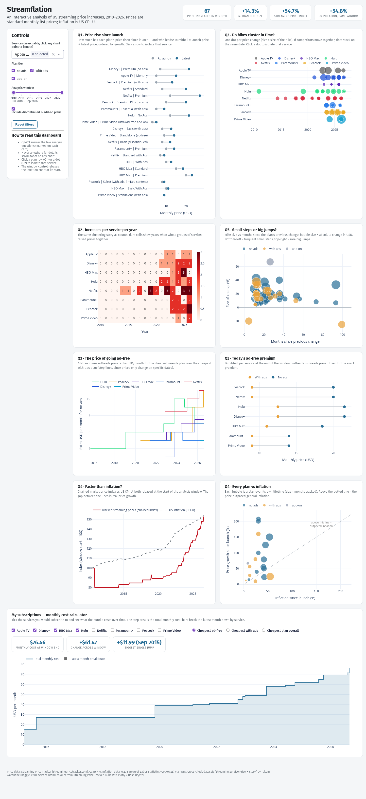

# Streamflation — An Interactive Analysis of US Streaming Price Increases, 2010–2026

An interactive Plotly + Dash dashboard for exploring how streaming subscription
prices in the US have evolved from June 2010 to September 2026 — how much each
plan has risen since launch, whether price hikes cluster in time, what the
ad-free upgrade costs, whether prices outpaced inflation, and what a personal
streaming bundle costs over time.



## Run it

```bash
pip install -r requirements.txt
python src/data_prep.py     # regenerate data/processed/ from data/raw/
python app/app.py           # http://127.0.0.1:8050
```

Or serve it in production mode (what the container runs):

```bash
gunicorn --chdir app --bind 0.0.0.0:8050 app:server
```

Requires Python 3.10+. Everything is offline — no keys, no network calls at runtime.

## Run with Docker

```bash
docker build -t streamflation .
docker run -p 8050:8050 streamflation     # http://localhost:8050
```

The image rebuilds `data/processed/` from the copied raw data at **build time**,
so the container always serves tables generated from exactly the raw files it
ships with. It runs 2 gunicorn workers behind the Dash layout and exposes a
`HEALTHCHECK` on `/`. For a cloud host, deploy the image as-is and map the
service port to container port **8050**.

## The five analysis questions

| # | Question | Chart(s) | Main interaction |
|---|---|---|---|
| Q1 | How much has each plan's price risen since launch? | Dumbbell (launch → latest per plan), ordered by growth | click a row to isolate the service |
| Q2 | Do price hikes cluster in time ("streamflation")? | Event timeline (dot size = hike) + service × year heatmap | zoom dates, click a dot to isolate |
| Q3 | How big is the ad-supported vs ad-free gap, and how has it changed? | Step lines of the gap over time + today's gap dumbbell | tier filter, window |
| Q4 | Have streaming prices risen faster than inflation? | Chained market price index vs CPI-U (rebased) + every plan vs inflation | **analysis window rebases the index** |
| Q5 | Do services raise prices in small steps or big jumps? | Bubble scatter: hike size vs months since previous change | hover, tier filter |
| + | *My subscriptions* calculator | Total monthly cost of a chosen bundle over time, with breakdown | tick services, pick tier mode |

The dashboard deliberately uses **dumbbells, event timelines, heatmaps,
stepped/gap lines, indexed lines and bubble scatter** rather than plain
bar/line/pie charts; each idiom was chosen for its task (see below).

## Data

| Source | Role | Licence |
|---|---|---|
| [Streaming Price Tracker](https://streamingpricetracker.com/) — `prices.csv`, one row per price change, 2010-06 → 2026-09 | main dataset | CC BY 4.0 |
| US CPI-U (CPIAUCSL), [FRED](https://fred.stlouisfed.org/series/CPIAUCSL) | inflation deflation & baseline (Q4) | public |
| [Kaggle: Streaming Service Price History](https://www.kaggle.com/datasets/webdevbadger/streaming-service-prices) | independent cross-check only (no chart) | CC0 |

Full provenance, access dates and scope filters: [data/raw/sources.md](data/raw/sources.md).

**Scope of the analysis** (group decision): `onDemand` services except ESPN
(a channel pass, not a streaming service) → **8 services, 20 plans, 89 price
events** (67 increases, 2 decreases). Live-TV services (YouTube TV, Sling,
fuboTV …) are in the raw data but excluded.

## Data preparation ([src/data_prep.py](src/data_prep.py))

One command regenerates every table the app reads. Steps:

1. **Validate** — 0 nulls, 0 duplicate (plan, date), all prices positive,
   every `plan_key` mapped to a tier ("with ads" / "no ads" / "add-on").
2. **Derive event statistics** — previous price, Δ$, Δ%, months since previous
   change, growth since launch, CAGR.
3. **Rebuild the monthly panel** — 1,821 rows; each plan's price holds until
   its next change (needed for bundle/index computations).
4. **Join CPI** — real prices in constant Sep-2026 dollars. The one genuinely
   missing CPI month (Oct 2025, BLS collection gap) is interpolated and
   *flagged* (`cpi_imputed`), never silently filled.
5. **Chained market price index** — equal-weight, matched-model (BLS-style):
   each month compares only plans present in both months, so a plan launching
   or retiring never moves the index by itself.
6. **Ad-free gap** — cheapest no-ads minus cheapest with-ads plan per service/month.
7. **Cross-check vs the Kaggle dataset** — 97.5% agreement over 570
   overlapping service-months. The 14 disagreements are *used as evidence*, not
   hidden: 10 are Kaggle's month-level lag on change dates, and 4 are a Netflix
   **tier switch** (Kaggle's famous +55% "increase" is actually Basic → Standard;
   the real Basic price went to $11.99, not $15.49).

Every check and finding is in [data/processed/validation_report.md](data/processed/validation_report.md).

## Design notes

**Task abstraction (Munzner's What–Why–How, as taught in the course):**

- *Why* — the five questions mix **discover** (Q2, Q5: open exploration) and
  **present** (Q1, Q3, Q4: comparison and lookup) tasks.
- *What* — the data is a **temporal** attribute (price) of **items** (plans) in
  a **hierarchy** (service → plan → tier).
- *How* — idiom choice follows the task:
  - dumbbells rank *change between two states* without a misleading zero baseline;
  - the event timeline answers Q2 because *temporal alignment of dots is
    exactly what "clustering" means*;
  - heatmaps for Q2b give the count-comparison view the timeline cannot;
  - bubble scatter encodes three variables (interval, size, direction) for Q5;
  - indexed lines with a rebasing window make "faster than inflation" a
    *question with a control* instead of a fixed claim;
  - steps (`hv` lines) everywhere prices are constant between changes — a
    smooth line would imply continuous change.

**Interaction design** — every control supports a question: service filter &
click-to-isolate (linked views across Q1/Q2), tier filter (Q3/Q5), the analysis
window (zoom + rebase for Q4), search, hover details everywhere, scroll-zoom,
and a reset. This is the brushing-and-linking pattern from the course's
advanced-interactivity material, applied at dashboard level.

**Visual consistency** — one tier palette (`no ads` blue, `with ads` amber,
`add-on` grey) in every chart; service colours taken from the source's own
brand colours so colour means the same thing across views.

## Key findings (default full window)

- **67 price increases vs 2 decreases** in 16 years — and both decreases are
  Hulu's ad-tier cuts (Nov 2010 $9.99→$7.99, Feb 2019 $7.99→$5.99), the only
  good news in the dataset.
- **Clustering is real, and accelerating:** changes per year 2022 → 7,
  2023 → 10, 2024 → 11, 2025 → 12, 2026 (9 months) → 15. The single densest
  month is **Oct 2025 (6 changes at once)**; Oct 2023 (5) and Oct 2024 (4)
  show a distinct autumn price-hike season (Q2 timeline + heatmap).
- **The biggest risers since launch:** Disney+ Premium +207% ($6.99 → $21.49),
  Apple TV +200% ($4.99 → $14.99), Peacock Premium (with ads) +160%
  ($4.99 → $12.99), Netflix Standard +150% (Q1 dumbbell).
- **Ad-free is a growing tax:** the gap has widened as services price the
  with-ads tier down and the no-ads tier up (Q3).
- **It depends on when you look:** over the full 2010–2026 window the chained
  price index (+54.7%) essentially matches CPI (+54.8%) — dragged down by
  Hulu's early cuts; from mid-2015 onward prices run **+85.9% vs +41.5%
  inflation** (Q4). The rebasing window control is what makes this honest.

## Project structure

```
work1/
├── README.md
├── requirements.txt       # pinned: pandas, plotly, dash, numpy, gunicorn
├── Dockerfile             # production image (gunicorn, healthcheck on /)
├── .dockerignore
├── data/
│   ├── raw/          # immutable inputs + sources.md (provenance & licences)
│   └── processed/    # generated by src/data_prep.py (safe to delete & regenerate)
├── src/
│   └── data_prep.py  # the whole data preparation & validation pipeline
├── app/
│   ├── app.py        # layout + Dash callbacks (filters, linked views, calculator)
│   ├── figures.py    # pure figure builders, one per chart
│   └── assets/style.css
└── docs/screenshots/ # dashboard_full.png, q1_dumbbell.png, header_kpis.png, calculator.png
```

## Caveats

- Prices are **US standard monthly list prices**; promotions, annual plans and
  bundles are excluded (scope of the source).
- `launch_date`/`launch_price` mean *first recorded* price, which may
  post-date the plan's true launch (Netflix's first recorded row is Nov 2010).
- CPI is national all-items inflation — it deflates prices but says nothing
  about the industry's own costs.
- The calculator uses list prices; it cannot know which plans a household
  actually holds or what they paid before a plan existed.

## Attribution

Price data: Streaming Price Tracker (streamingpricetracker.com), [CC BY 4.0](https://creativecommons.org/licenses/by/4.0/) —
service brand colours also from Streaming Price Tracker. Inflation data: U.S.
Bureau of Labor Statistics (CPIAUCSL) via FRED. Cross-check: "Streaming Service
Price History" by Takumi Watanabe (Kaggle, CC0). Built with Plotly + Dash (PyViz).
